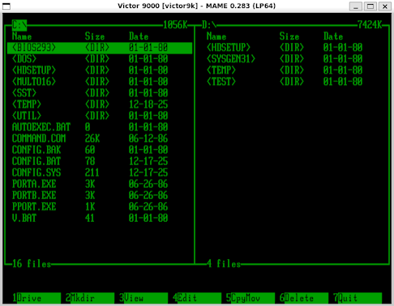

# Intergalactic Commander ~ File Manager for Victor 9000

**A two-pane file manager for Victor 9000 DOS 3.1, inspired by Volkov Commander.**  



## Executables
- Victor 9000 [igc.exe](bin/igc.exe)
- Windows Serial server [igcfs.exe](tools/serialfs/igcfs.exe)

## Known issues / Limitations

- **DOS < 2.11** - Untested
- **DOS 2.11** - Selecting an empty floppy drive falls back to DOS
- **Speed issues** - Uses DOS file access, some things are slow
- **Keys** - Non-Standard/American keyboard configs may not map 100%

## Features

- **Dual-pane interface** - Navigate two directories simultaneously
- **File operations** - Copy, move, delete, rename files and directories
- **Built-in editor** - View and edit text files
- **Dynamic memory scaling** - Works on systems from 256KB to 512KB+ RAM
- **Fast display** - Direct VRAM access for responsive UI
- **Serial file transfer** - Browse a directory on a modern PC over a serial cable and copy files and whole directory trees to/from the Victor
- **Disk images** - Read a Victor floppy into a `.IMG` / `.RLE` image file, or write an image back onto a floppy (local drive or serial server)
- **Mouse support** - Optional. Click files, F-keys, dialog buttons and editor text with a Microsoft-compatible serial mouse (needs the Victor mouse driver, see below)

## Keyboard Controls

### Navigation
| Key | Action | Vic Key |
|-----|--------|---------|
| Tab | Switch between panels | |
| Up/Down | Move cursor | |
| Left/Right | Parent directory / enter directory | |
| PgUp/PgDn | Scroll page | Word arrow keys |
| Home/End | Jump to first/last file | |
| Enter | Open directory or view file | |
| Backspace | Go to parent directory | |
| Space | Select/deselect file | |
| Esc or Q | Quit | |

### Function Keys
| Key | Action |
|-----|--------|
| F1 | Change drive |
| F2 | Create directory |
| F3 | View file (read-only) |
| F4 | Edit file |
| F5 | File Ops: (C)opy, (M)ove, (D)elete or (R)ename |
| F6 | More: disk images (copy disk to image file, write disk from image file) |
| F7 | Quit (F10 also quits) |
| F8 | (unassigned) |

## Mouse

IGC uses the mouse when the Victor serial mouse driver is loaded before it starts:
either `device = mouse.dev a` in CONFIG.SYS (the RAT disk driver) or the `MOUSE.COM`
TSR built from it (run `MOUSE A` or `MOUSE B` at the prompt; it only stays resident if a mouse
answers on that port); both live in [`../mouse/`](../mouse/).
Without a driver IGC
behaves exactly as before. The pointer is a reverse-video cell and is shown while
IGC is waiting for input. The mouse can share the machine with the serial file
server: put the mouse on one port and the PC cable on the other (see below).

| Where | Left click | Double-click | Right click |
|-------|-----------|--------------|-------------|
| File rows | Activate that panel and move the cursor to the file | Open the directory, or View (F3) a file | Move the cursor there and toggle its selection (cursor stays) |
| Panel title bar | Activate that panel | | |
| F-key bar (bottom row) | Same as pressing that F-key | | |
| Dialog buttons | Press the button ([Yes] [No] [OK] [Cancel]) | | |
| Drive list, F6 menu, floppy list | Select the row; click it again to choose it | Choose the row | |
| Rename / Mkdir input field | Put the text cursor there | | |
| Editor text | Put the cursor there | | |
| Editor help bar | Save, Cut, Paste, Exit as labelled | | |

A click on any "press a key" message dismisses it, like a key.

## Serial File Transfer

IGC can browse a directory on a modern PC over a simple 3-wire null-modem RS-232
cable and copy files in both directions — handy for moving programs and data on/off
the Victor without floppies.

### On the Victor (client)

Press **F1** (Change drive) on a pane and select **Serial A** or **Serial B** at
the bottom of the drive list, whichever port the cable is on. If the mouse driver
is loaded, its port is shown as `Serial B (mouse)` (or A) and cannot be chosen:
the driver owns that channel and connecting there would cut the mouse off.
The pane then browses the directory served by the PC and
supports the usual operations: browse, view/edit, copy in/out, delete and rename
(all under F5), mkdir (F2), and disk images (F6). Copy, move and delete handle whole
directories too — a selected folder is copied recursively (single or nested) in
either direction. The path is shown as `SERA:\...` or `SERB:\...`. Remote files are presented as
uppercase 8.3 names (long/mixed-case names are mangled to `NAME~1.EXT`).

Copying a file from the server over an existing local file asks before
overwriting (Yes/No/All), like a local copy. Uploads and recursive directory
copies overwrite silently — the server side cannot be probed per file.

The link runs **8N1 at 38400 baud over a 3-wire cable (no hardware flow control)**.

> **Version pairing:** igc waits for the server to confirm each upload after
> the transfer completes, and disk images use protocol commands only a current
> igcfs knows, so `igc.exe` and `igcfs` must be updated together — a new igc
> against an old igcfs reports every upload as failed and says "Server does not
> support disk images".

### On the PC (server)

The PC-side server, `igcfs.py`, lives in [`tools/serialfs/`](tools/serialfs/).
It serves one directory (sandboxed to it) to the Victor.

```sh
cd tools/serialfs
python3 -m venv .venv
.venv/bin/pip install -r requirements.txt

# Serve /srv/victor over /dev/ttyUSB0 at 38400 baud
.venv/bin/python igcfs.py --root /srv/victor --dev /dev/ttyUSB0 --baud 38400 -v
```

| Option | Meaning |
|--------|---------|
| `--root` | Directory to serve (server is sandboxed to it) |
| `--dev` | Serial device (default `/dev/ttyUSB0`) |
| `--baud` | Line rate (default 38400; must match the Victor's pane setting) |
| `-v` | Verbose request log |

> **Cable note:** the link is 3-wire (TX/RX/GND). The Victor uses *polled* serial
> and never toggles RTS, so hardware flow control does nothing; reliable
> multi-packet transfers come from the Victor's lean polled-receive path. A plain
> TX/RX/GND cable is all you need — see [`tools/serialfs/README.md`](tools/serialfs/README.md)
> for the full protocol and baud-rate notes.

## Disk images

F6 (More) copies a whole Victor floppy to an image file and back, one track at
a time through DOS (INT 25h / 26h). Only drives A: and B: are offered.

- **`.IMG`** is the raw image in DOS sector order, exactly what MAME uses:
  626,688 bytes for a single-sided disk, 1,224,192 for a double-sided one.
- **`.RLE`** is the same image run-length compressed (the serial link's RLE
  scheme) behind a 16-byte header holding the raw size and a CRC-32. Mostly
  empty disks shrink a lot.

**Copy disk to image file:** pick the floppy, then type a file name (default
`DISK.RLE`; the extension `.IMG` or `.RLE` picks the format). The prompt
shows the destination above the name: the active pane's directory, on a local
drive or the serial server (an existing file of that name asks before being
overwritten). Sidedness comes
from the disk label. Esc between tracks aborts and deletes the partial image.

**Write disk from image file:** put the cursor on a `.IMG` / `.RLE` file in the
active pane (local or serial), press F6, choose the target floppy and confirm.
The target must already be a **formatted Victor disk of the same sidedness**
(the Victor's GCR format cannot be laid down through DOS); everything on it is
overwritten. A local `.RLE` is decoded and CRC-checked in full before the first
track is written, so a truncated or corrupt file is refused while the floppy is
still intact (the server does the same check for serial images). A read or
write error offers Retry / Abort per track. IGC refuses to write onto the disk
it was started from.

On the PC, `tools/serialfs/v9kimg.py` converts between the formats
(`pack` .IMG to .RLE, `unpack` .RLE to .IMG, `info`).

## Installation

Copy `IGC.EXE` to your Victor 9000 hard drive or floppy disk.

## Building from Source

Requires Open Watcom v2 compiler.

```bash
make            # Build igc.exe
make clean      # Remove build artifacts
make deploy     # Deploy to MAME disk image
```

Output: `bin/igc.exe` (~50KB)

## System Requirements

- Victor 9000 / Sirius 1 computer
- DOS 3.1 or compatible
- Minimum 256KB RAM (scales with available memory)

### Memory Scaling

The program automatically adapts to the free RAM detected at startup:

| Free Memory | Files per Panel | Editor Buffer |
|-------------|-----------------|---------------|
| < 64KB | 64 | 4KB |
| 64-128KB | 256 | 16KB |
| 128-200KB | 512 | 32KB |
| > 200KB | 1024 | 64KB |


